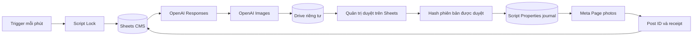

# Kiến trúc và các quyết định vận hành

## Luồng dữ liệu

Một tick ưu tiên phục hồi receipt, bài đến hạn, lệnh quản trị, công việc TEXT/IMAGE, sau đó tạo kế hoạch. Mỗi tick gọi tối đa một công việc tạo nội dung/ảnh. Tạo ý tưởng có ID cố định theo ngày/slot, lưu kế hoạch trước khi append để phục hồi sau lỗi append giữa chừng. Retry chuẩn bị ý tưởng cách nhau một giờ khi lỗi; nội dung/ảnh thử tối đa ba lượt với exponential backoff. Lỗi HTTP 429/5xx của OpenAI có retry ngắn; request có thể phát sinh chi phí lại nếu kết quả trước đó không được nhận.

## Trạng thái

Trạng thái người dùng: Chờ duyệt / Đã duyệt / Từ chối / Đã đăng / Lỗi. Giai đoạn kỹ thuật: TEXT → IMAGE → READY → DONE. Lỗi tạo nội dung giữ giai đoạn để có thể tiếp tục. Chọn Viết lại quay về TEXT và tạo ảnh mới; chọn Tạo lại ảnh quay về IMAGE. Cả hai đều hủy phê duyệt.

on-edit trigger lưu SHA-256 của nội dung, lịch, ảnh, nguồn vào Script Properties và cột U, đồng thời lưu hash byte ảnh riêng. Publisher kiểm tra cả hai dấu với snapshot mới đọc từ Sheet và kiểm tra lại byte ảnh trước khi gửi. Nếu sửa nội dung sau duyệt, dấu không khớp nên không đăng kể cả khi trigger edit chưa kịp chạy. Chỉnh sửa một vùng gồm cả trạng thái Đã duyệt được hiểu là quản trị chủ động duyệt snapshot cuối cùng của vùng đó. Sau khi bắt đầu request Meta, thay đổi Sheet không thể hủy request đang gửi; dừng trước thời điểm đăng nếu cần hủy chắc chắn.

## Chống trùng và kết quả chưa xác định

LockService chống nhiều trigger cùng tác động trong một script. Không chạy nhiều bản script trên cùng CMS. Mỗi bài có journal `publish:ID` trong Script Properties. Ghi INTENT trước POST `/PAGE_ID/photos` với `source` blob Drive và `published=true`. Không cần public ảnh Drive.

Khi nhận `post_id`, ghi DONE vào journal trước khi cập nhật Sheet. Nếu Sheet lỗi, tick sau lấy receipt để phục hồi. Nếu POST timeout, response không đủ thông tin hoặc script bị dừng sau INTENT, bài bị giữ để quản trị đối soát, tuyệt đối không tự gửi lại. Đây là cơ chế ưu tiên tránh đăng trùng với xử lý thủ công khi kết quả không chắc chắn, không khẳng định exactly-once giao dịch giữa Google và Meta.

Journal không thể bảo vệ nếu quản trị xóa Properties, đổi ID, copy hàng sang ID mới, hoặc chạy bản sao script. Không sửa ID/kỹ thuật, không xóa hàng đã đăng. Quyền owner của script là quyền tin cậy hoàn toàn, không phải ranh giới bảo mật trước người quản trị cố ý sửa mã.

## Chất lượng nội dung

Kiểm tra ý tưởng trùng chuỗi đã chuẩn hóa trên tối đa 250 bài gần nhất, đồng thời yêu cầu model tránh trùng ý nghĩa. Không đảm bảo chống trùng ngữ nghĩa tuyệt đối. Ảnh có prompt biến thể, kiểm tra trùng byte bằng SHA-256; không có nhận diện ảnh giống nhau về thị giác. Bản MVP dùng ảnh vuông 1024×1024. Không ép tỷ lệ 4:5 vì kích thước model phụ thuộc API.

MVP không tự duyệt web/nghiên cứu thời sự. Tab Sources lưu thông tin + URL chính thức + ngày quản trị kiểm chứng; AI chỉ được trích URL từ danh sách đó, không tự truy cập nội dung URL. Khi thiếu tư liệu, dùng kiến thức evergreen và ví dụ ghi rõ giả định. Không có cơ chế tự động chứng minh mọi phát biểu đúng; quản trị chịu trách nhiệm kiểm tra trước duyệt.

Link Drive giữ riêng tư; cột Xem trước hiển thị lời nhắc mở link thay vì IMAGE() yêu cầu công khai ảnh. Không sử dụng URL Drive để Meta tải ảnh; publisher tải blob bằng tài khoản chạy trigger rồi upload multipart.

## Lịch, quota và bảo mật

Lịch Asia/Ho_Chi_Minh (UTC+7), ba slot 08:00, 12:00, 19:30. Tick mỗi phút chỉ là lịch gần đúng; runtime/lock/network/quota có thể làm trễ. Bài chưa duyệt giữ chờ; duyệt muộn trong cửa sổ MAX_LATENESS_MINUTES sẽ đăng tick tiếp theo. Ngoài cửa sổ phải đổi lịch, duyệt lại. Không tự bù các ngày hệ thống ngừng chạy.

Chỉ chia sẻ Sheet cho quản trị tin cậy. Cột N:Z bảo vệ owner-only; owner dùng cột X để ra lệnh. Muốn editor khác ra lệnh, owner có thể cấp quyền riêng cột X và duy trì bảo vệ cột còn lại. Không mời người không tin cậy làm editor bound script vì họ có thể truy cập secrets. Logs không ghi caption hoặc raw HTTP body, có redaction token/key. Chi phí OpenAI bị tính cả trong DRY_RUN; DRY_RUN chỉ ngăn đăng Facebook.

Apps Script có giới hạn execution và tổng runtime trigger. Một request tạo ảnh vẫn có thể vượt thời gian; script này không có worker server hoặc background image polling. Bắt đầu quality low, ba ảnh/ngày; theo dõi Executions/quota/billing. Script Properties có giới hạn lưu trữ: kế hoạch và journal tích lũy cần backup và lưu trữ định kỳ. Không xóa receipt của bài còn nằm trong CMS; khi archive, lưu snapshot CMS + journal trong kho riêng rồi đưa bản vận hành sang dự án mới sau đối soát. Logs cũng cần archive khi lớn. Đây là MVP quy mô một Fanpage, chưa phải nền tảng đa khách hàng.
